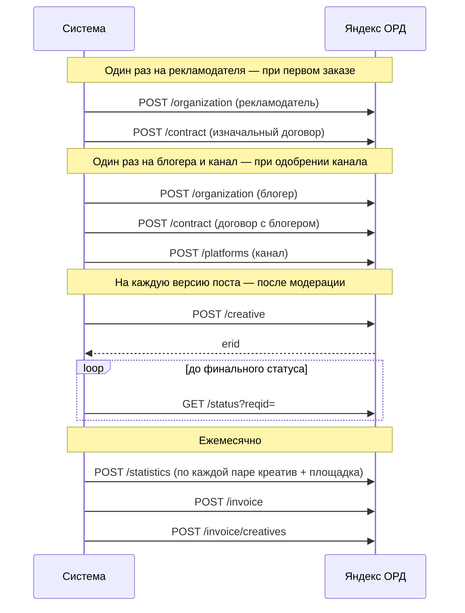

# 05. Интеграции

Контракт Рокет Ворк зафиксирован в [исходной OpenAPI](../roketwork_openapi.json).
[Матрица 28 операций](../internal/integration/rocketwork/testdata/coverage.json) содержит JSON Pointer запросов/ответов, денежные единицы, побочные эффекты, восстановление и задачу реализации для каждого метода. `planned` и `partial-read` не означают готовность; `excluded` содержит причину исключения. [Реестр неоднозначностей](../internal/integration/rocketwork/testdata/schema-defects.json) определяет пределы схемной проверки. Исходный документ не нормализуется на диске, тест проверяет SHA-256. Примеры документа — источник контракта, не подтверждение живого прогона.

**Назначение.** Как система работает с внешними сервисами: что вызывает, что получает, как переживает ошибки. По документу пишутся адаптеры.

**Связанные документы.** [03-placement.md](03-placement.md) — какие переходы запускают вызовы; [04-domain-model.md](04-domain-model.md) — где хранятся внешние идентификаторы; [07-non-functional.md](07-non-functional.md) — планировщик и журналирование.

**Затронутые записи реестра.** D-01, D-03, D-05, D-06, D-07, D-08, D-10, D-14, D-18, D-19, D-22, D-23, D-25, D-27, A-01, A-02, A-04, A-05, A-17, A-21, A-23, A-27, A-28, A-31, A-32, A-33, A-35, A-36, A-38, A-41, A-42, Q-01, Q-03, Q-04, Q-05, Q-06, Q-07, Q-08, Q-09, Q-10, Q-11, Q-12, Q-13, Q-14, Q-15, Q-16, Q-26, Q-30, Q-31, Q-32, Q-35, Q-36, Q-38, Q-39.

Источник фактов — исследование. Всё, что там не подтверждено документацией или живой проверкой, помечено вопросом реестра и собрано в подразделах «Не подтверждено». Имена методов и полей, которых нет в исследовании, в документе не приводятся: адаптер пишется по актуальной документации сервиса.

## 1. Общие правила

**Живое наблюдение MAX, 2026-11-03:** GET технического поста, опубликованного ботом от имени канала, не содержит `sender`; `stat.views` присутствует. Диагностический прогон сверяет сохранённый ID и маркер запуска в канале. Отсутствие `sender` само по себе не доказывает, что пост создан человеком. Хеш текстового POST/GET совпал; event, альбом, стили и удаление через 72 часа ещё не подтверждены. Подробности и обезличенный fixture — в [матрице проверок](launch/integration-checks.md). Общий recovery приложения по автору требует отдельной проверки.

Действуют для всех внешних систем.

**Адаптер.** Каждая система закрыта интерфейсом на языке предметной области (`PublishPost`, `RegisterCreative`, `CreatePayout`). Остальной код не знает адресов, форматов и кодов ошибок внешней системы (A-28). У каждого интерфейса есть поддельная реализация для тестов и локального запуска.

**Где вызывать.** Только из задания планировщика, никогда — внутри транзакции перехода состояния (I-13) и никогда — в обработчике запроса пользователя. Сведения о канале и права бота при подключении тоже читает задание (`refresh_channel_info`, §2.4): событие `bot_added` приходит Webhook, ответ на него не ждёт MAX.

**Таймауты.** Соединение — 5 с; запрос целиком — 30 с; загрузка файла — 120 с.

**Повторы.** Повторяются сетевые ошибки, таймауты, ответы `5xx` и `429`. Ответы `4xx`, кроме `429`, не повторяются: это ошибка данных, объект переводится в состояние ошибки. Внутри одного запуска задания — до 3 попыток с задержками 1, 2, 4 с. Дальше — повтор задания по правилам планировщика (07 §2). При `429` задержка берётся из ответа, если он её сообщает.

**Неизвестный исход.** Если запрос на создание завершился таймаутом, перед повтором адаптер проверяет, не создан ли объект (03 §11). Если система принимает ключ идемпотентности — он передаётся всегда.

**Успех проверяется по телу.** Ответ `200` может означать отказ: MAX возвращает `success=false` при удалении. Адаптер разбирает тело и превращает такой ответ в ошибку.

**Предохранитель.** После 10 ошибок подряд по одной системе вызовы к ней приостанавливаются на 60 с; задания откладываются. Событие — уровень ERROR и оповещение администратору.

**Сохранение запросов.** Каждый вызов записывается в `outbound_request`: система, операция, попытка, запрос без секретов, код и тело ответа, длительность, связанный объект. Заголовок `Authorization` не сохраняется. Адаптер может подменить сохраняемое тело запроса: ОРД пишет ИНН маскированным (`77****3893`), а вместо текста креатива — его длину; ответ ОРД сохраняется целиком.

**Секреты.** Токены хранятся в хранилище секретов окружения, в базе — только зашифрованными (07 §4). В журнал и в `outbound_request` не попадают.

**Журналирование.**

| Событие | Уровень | Поля |
|---|---|---|
| Вызов начат и завершён | DEBUG | система, операция, идентификатор запроса, попытка, длительность, код ответа |
| Операция выполнена (объект создан, пост опубликован, выплата отправлена) | INFO | система, операция, наш объект, внешний идентификатор |
| Попытка не удалась, будет повтор | WARN | то же и текст ошибки |
| Повторы исчерпаны или получен отказ `4xx` | ERROR | то же и тело ответа без персональных данных |
| Сработал предохранитель | ERROR | система, число ошибок |

## 2. MAX Bot API

Единственная площадка размещения (D-01).

### 2.1. Доступ

| Параметр | Значение |
|---|---|
| Адрес | `https://platform-api2.max.ru` |
| Авторизация | Токен бота в заголовке `Authorization` |
| Сертификат | Сервер использует сертификат Минцифры: корневой сертификат добавляется в доверенные в образе приложения |
| Получение событий | В продакшене — только Webhook по HTTPS с доверенным сертификатом. Long Polling — только в разработке |
| Лимиты | До 30 запросов в секунду на платформу; до 2 сообщений в секунду в один канал |
| Клиент | Собственный тонкий HTTP-клиент по OpenAPI-схеме внутри адаптера. Официальный клиент для Go `max-messenger/max-bot-api-client-go` не используется: каждая попытка записывается в `outbound_request`, а повторы и предохранитель общие для всех систем (§1) |
| Описание API | OpenAPI-схема `max-messenger/api-schema` |

Создание бота для верифицированного ИП подтверждается [документацией MAX](https://dev.max.ru/docs/chatbots/bots-create/create), проверенной 2026-11-02. Владелец сообщил о наличии тестового бота и канала; GET /me подтвердил токен 2026-11-03; доступ к тестовому каналу пока отклоняется. Продакшен и тестовый контур должны использовать разных ботов; состояние Q-01 и остальных проверок — в [матрице](launch/integration-checks.md).

### 2.2. Webhook и события

Приём события:

1. Проверить подлинность запроса (Q-35): секретная часть пути `/webhooks/max/{secret}` и секрет подписки в заголовке `X-Max-Bot-Api-Secret`, оба за постоянное время. Не прошло — ответ `401`, запись уровня WARN; пять отказов за 10 минут — оповещение. Приём — отдельный обработчик с сырым телом, а не сгенерированный по спецификации: ключ события считается от тела как есть.
2. Сохранить тело в `inbound_event` с уникальным ключом. Ключ — идентификатор события, если MAX его передаёт; иначе SHA-256 от тела.
3. Если ключ уже есть — ответить `200` и больше ничего не делать.
4. Создать задание обработки и ответить `200`. Обработка в самом запросе не выполняется.

Реакция на события:

| Событие | Условие | Реакция | Сценарий |
|---|---|---|---|
| `bot_added` | Это канал | Создать или восстановить канал, сохранить `added_by_max_user_id`, запросить сведения и права. Новый канал — `unclaimed` до кода подключения (A-41) | S-12 |
| `bot_added` | Это не канал | Бот покидает чат | — |
| `bot_removed` | Канал известен | Канал `disconnected`; обработать размещения | S-25 |
| `bot_admin_permissions_changed` | Канал известен | Обновить права; сменить состояние канала; обработать размещения | S-12, S-25 |
| `message_created` | Диалог с ботом | Ответить инструкцией: как зарегистрироваться и подключить канал. Привязки аккаунта MAX нет (D-25) | — |
| `message_created` | Канал `unclaimed`, текст — действующий код подключения | Связать канал с организацией кода, удалить сообщение, погасить код (A-41) | S-12 |
| `message_created` | Канал, автор — не наш бот | Проверить «часы в топе» по размещениям канала | S-27 |
| `message_created` | Канал, автор — наш бот | Ничего | — |
| `message_edited` | Сообщение — наша публикация | Сравнить с версией поста | S-26 |
| `message_removed` | Сообщение — наша публикация и удаляли не мы | Зафиксировать досрочное снятие | S-26 |
| `chat_title_changed` | Канал известен | Обновить название | — |
| `user_added`, `user_removed`, `message_callback`, события комментариев | — | Сохранить как `ignored` | — |

Событие `bot_admin_permissions_changed` приходит только через Webhook. Чтобы отличить собственное удаление от чужого, задание снятия записывает `publication.removed_at` до вызова удаления.

Маршрут событий о сообщениях: `message_created` разбирает модуль каналов — код подключения обрабатывает сам, остальные сообщения известного канала передаёт модулю размещений через порт (контроль топа); `message_edited` и `message_removed` разбирает модуль размещений по идентификатору сообщения публикации. Бот подписывается на все виды из таблицы; если подписка на наш адрес есть, но без какого-либо вида, `worker` подписывает бота заново при запуске.

### 2.3. Используемые методы

| Метод | Назначение | Что передаём | Что берём из ответа |
|---|---|---|---|
| `POST /messages?chat_id=` | Публикация поста в канал |
| `POST /messages?user_id=` | Сообщение блогеру по `channel.added_by_max_user_id` (A-41). Доставка не гарантирована, если блогер не писал боту, — Q-38 | `text`, `format` | Идентификатор сообщения | `text` до 4000 символов, `attachments`, `format`, `disable_link_preview` | `Message`: идентификатор, `url` — публичная ссылка, `stat` (только для каналов) |
| `DELETE /messages?message_id=` | Снятие поста | Идентификатор сообщения | `success` в теле — проверять обязательно |
| `GET /messages/{id}` | Проверка наличия и содержания публикации, просмотры | — | Текст, вложения, `stat.views` |
| `GET /messages?chat_id=` | Сверка «часов в топе», метрики каталога, поиск публикации после неизвестного исхода | `from` — верхняя граница времени, `to` — нижняя, обе в миллисекундах Unix; `count` 1…100 | Список сообщений, новые первыми. Бот должен быть администратором, иначе `403` |
| `GET /chats/{chatId}` | Сведения о канале | — | `participants_count`, `messages_count`, `title`, `icon`, `description`, `is_public`, `link`, `owner_id` |
| `GET /chats/{chatId}/members/me` | Права бота | — | `permissions` |
| `POST /uploads` | Загрузка изображения | Файл | Токен вложения |
| `DELETE /chats/{chatId}/members/me` | Бот покидает чат: не канал или канал не подключён за 7 суток (A-41) | — | `success` в теле |
| `GET /subscriptions`, `POST /subscriptions` | Подписка бота на Webhook при запуске `worker` в продакшене, если нашего адреса нет | Адрес, виды событий, секрет | Список подписок, `success` |

Не используются: `PUT /messages` — рекламный пост после публикации не редактируется (D-03); `GET /chats` — отключён, список каналов ведётся по событиям `bot_added` и `bot_removed`.

Права из `permissions`: `write` — публикация, `delete` — удаление, `edit`, `read_all_messages`, `pin_message`, `change_chat_info`, `add_admins`, `add_remove_members`, `view_stats`. Обязательны `write` и `delete` (A-01). `view_stats` боты не получают.

### 2.4. Подключение канала

Основной сценарий с 2026-11-11: блогер добавляет бота администратором канала,
затем вводит название, @тег, ссылку или ID в кабинете. POST `/blogger/channels/connections`
принимает `channel_name`; worker находит канал среди сохранённых событий MAX,
читает сведения и права бота через `GET /chats/{chatId}` и
`GET /chats/{chatId}/members/me`, затем атомарно связывает канал с организацией.
Проверяются write/delete бота, а не права человека MAX. Личный диалог и публикация
не нужны. Неоднозначное название требует ссылки или ID, чужой владелец не меняется.
Статус доступен по GET сессии; refresh повторяет поиск по сохранённому имени.

Ниже — старый сценарий с кодом, сохранённый для совместимости прежних клиентов:

1. Событие `bot_added` с признаком канала. Из него: идентификатор чата и пользователь MAX, добавивший бота; он записывается в `channel.added_by_max_user_id`.
2. Канала с таким `max_chat_id` нет — создать в состоянии `unclaimed`. Если канал уже принадлежит другой организации — не менять владельца, записать в журнал действий, уведомить администратора.
3. Событие `message_created` в канале `unclaimed` с текстом, равным действующему коду `auth_code` (`purpose = channel_link`): записать `channel.organization_id` из кода, удалить сообщение с кодом (`DELETE /messages`), погасить код. Сообщения с неверным или просроченным кодом не обрабатываются.
4. `GET /chats/{chatId}` — сохранить название, описание, значок, ссылку, признак публичности, число подписчиков.
5. `GET /chats/{chatId}/members/me` — сохранить права.
6. Состояние: есть `write` и `delete` → `moderation`; иначе `pending_rights` с причиной. Публичные и приватные каналы допускаются одинаково; публичная ссылка не требуется.
7. При `bot_admin_permissions_changed` шаги 5–6 повторяются. Канал, уже прошедший модерацию, при возврате прав возвращается в `active` без повторной проверки.
8. При `bot_removed` — канал `disconnected`, состояние до отключения сохраняется в `channel.status_before_disconnect`. Повторное добавление бота возвращает канал в прежнее состояние, если он был `active` или `suspended` (через `suspended` до чтения прав), и в `moderation` (через `pending_rights`) в остальных случаях. Организация канала не меняется, `added_by_max_user_id` обновляется.

Правила состояния канала после чтения прав (одна функция в `channel/domain`):

| Состояние | Права бота в порядке | Нет `write` или `delete` |
|---|---|---|
| `unclaimed` | `unclaimed` | `unclaimed` |
| `pending_rights` | `moderation` | `pending_rights` |
| `moderation` | `moderation` | `pending_rights` |
| `active` | `active` | `suspended` |
| `suspended` (из-за прав) | `active` без модерации | `suspended` |
| `rejected`, `blocked`, `disconnected` | без изменений | без изменений |

Причина (`status_reason`): `missing_rights` — не хватает прав (перечень — `missing_permissions` в кабинете). Приватность не создаёт отказа или приостановки. Исторический `not_public` снимается после обновления сведений и прав; остальные проверки выполняются заново.

Порядок событий и отклонения:

- События разбираются заданиями параллельно, каждый обработчик блокирует строку канала. Код в канале, о котором ещё нет `bot_added`, разбирается повторно раз в минуту в течение 5 минут, затем событие получает `ignored`.
- Код — 8 символов из алфавита `23456789ABCDEFGHJKLMNPQRSTUVWXYZ`, регистр и пробелы по краям не важны. В базе — HMAC-SHA256 с секретом окружения. У организации один живой код: новый гасит прежний; не больше 10 кодов в час.
- Код другой организации в подключённом канале: владелец не меняется, код остаётся живым, сообщение удаляется, запись в журнал действий `channel.link_rejected` и оповещение администратору. Код своей организации в своём канале просто гасится.
- Канал в `unclaimed` дольше 7 суток (`CHANNEL_UNCLAIMED_TTL`) получает `disconnected` с причиной `unclaimed_expired`, бот покидает канал. Повторное добавление бота снова даёт `unclaimed`.
- Все вызовы MAX выполняют задания `refresh_channel_info`, `delete_max_message`, `leave_max_chat`, `reply_bot_dialog` (07 §2) вне транзакции; обработчик события только меняет базу и ставит задания.
- При потере канала (`active` → другое) и при возврате (`suspended` → `active`) модуль каналов в той же транзакции вызывает порт размещений: последствия для размещений (S-25 шаг 2) реализует модуль размещений.

Владение каналом подтверждается тем, что код из кабинета появился в канале: добавить бота администратором и писать в канал может только тот, у кого есть на это право (A-41). Шаги 4–6 выполняются после `bot_added`, а переход в `moderation` — только когда канал связан с организацией.

### 2.5. Форматирование и сериализация

Редактор хранит документ в собственной схеме (`post_version.content_doc`), сериализатор превращает его в текст для API (D-05). Формат API — `html`: в нём однозначно выражаются подчёркивание и выделение.

| Элемент редактора | Тип | В MAX |
|---|---|---|
| `bold` | метка | Жирный |
| `italic` | метка | Курсив |
| `underline` | метка | Подчёркнутый |
| `strike` | метка | Зачёркнутый |
| `code` | метка | Моноширинный |
| `link` | метка с адресом | Ссылка |
| `highlight` | метка | Выделение (`<mark>`) |
| `heading` | блок | Заголовок. Уровень один: в MAX все уровни выглядят одинаково |
| `blockquote` | блок | Цитата |
| `paragraph` | блок | Абзац |

Чего в схеме нет и что редактор отбрасывает при вставке: списки, спойлеры, таблицы, упоминания пользователей, изображения внутри текста.

Правила сериализатора:

- Теги сверены со страницей документации MAX о форматировании (dev.max.ru, `docs-api/use-cases/sending-messages/text-formatting`): `<b>`, `<i>`, `<u>`, `<s>`, `<code>`, `<a href="…">`, `<mark>`, `<h1>`, `<blockquote>`. Страница допускает и синонимы (`<strong>`, `<em>`, `<ins>`, `<del>`, `<pre>`, `<h2>`–`<h4>`); сериализатор их не использует. Блоки разделяются `
`; `
` внутри текста — перенос строки. Сериализатор покрывается тестами, которые публикуют каждый элемент в тестовый канал и читают его обратно (этап «Проверки и доступы»).
- Спецсимволы HTML в пользовательском тексте и в адресах экранируются: `&`, `<`, `>`, `"`. Страница MAX правил экранирования не называет — проверяется на тестовом канале.
- Вложенность меток допускается, порядок вложения фиксирован: `link` снаружи, затем `bold`, `italic`, `underline`, `strike`, `highlight`, `code`. Страница MAX о вложенности молчит; рабочий ответ на Q-06 реализован, проверка — на тестовом канале.
- Длина считается в кодовых единицах UTF-16 по сериализованной строке вместе с разметкой и UTM-метками: это не мягче любого способа подсчёта на стороне MAX (эмодзи — 2 единицы). Предел для `body` — 3800, для `final_text` — 4000 (A-38); пределы — параметры `POST_BODY_LIMIT`, `POST_FINAL_TEXT_LIMIT` (07 §8). Резерва 200 знаков не хватает строке маркировки с названием длиннее примерно 140 символов (название организации — до 500): такой пост предпросмотр показывает с проблемой `body_too_long`, а переход версии в `ready` с итоговым текстом длиннее 4000 отклоняется.
- Адреса ссылок — только `https://`, есть хост, нет `userinfo` и пробелов, не длиннее 2048. К адресу добавляются UTM-метки, которых в нём нет: `utm_source=max`, `utm_medium=channel_ad`, `utm_campaign=order_{номер заказа}` (A-21). Недостающие метки дописываются в конец строки запроса, заданные не меняются, фрагмент `#…` остаётся в конце. Метки ставятся при создании версии, с настоящим номером заказа; в предпросмотре вместо номера — заглушка `order_0000000000` фиксированной ширины.
- Адреса в тексте распознаются автоматически при сохранении черновика (D-22): фрагмент от `https://` в начале узла или после символа, который не буква и не цифра, до пробела или конца строки становится ссылкой — так же, как ссылка, добавленная кнопкой «Ссылка»; остальные метки фрагмента сохраняются. В адрес не входят завершающие `.,;:!?»"'`, а также `)`, если внутри адреса нет парной `(`. Фрагмент, который не проходит проверку адреса, остаётся текстом. Распознанные и добавленные вручную ссылки обрабатываются одинаково: UTM-метки (A-21) и параметр `erid`, если erid в ссылке (A-38).
- Перед распознаванием документ нормализуется: CRLF и CR — в LF, табуляция — в пробел, прочие управляющие символы удаляются; повторы меток убираются; пустые узлы удаляются, соседние с одинаковыми метками сливаются; пустой абзац сохраняется. Пределы: 300 блоков, 3000 текстовых узлов, 128 КБ JSON.

Сборка `final_text` при переходе версии в `ready` зависит от места токена (D-18, A-38):

```
{строка маркировки, если erid над постом}
{body}

{строка маркировки, если erid под постом или в ссылке}
```

Строка маркировки собирается из частей через пробел: `Реклама. {advertiser_name}, ИНН {advertiser_inn}.` — если пометка в тексте (`token_carrier = text`); `erid: {erid}` — если erid над или под постом. При erid в ссылке к каждой ссылке поста добавляется параметр `erid={erid}`, а в строке остаётся только пометка. Если пометка на плашке, а erid в ссылке, строки маркировки нет. Строка маркировки — обычный текст без разметки: спецсимволы HTML в названии экранируются. Состав сведений — рабочий (Q-30).

### 2.6. Вложения, публикация, снятие

Публикация (S-21):

1. Для каждой строки `post_version_media` по порядку: прочитать файл производной из закрытой области хранилища (не по публичной ссылке), загрузить через `POST /uploads` и передачу файла по выданному адресу, получить токен вложения. Токены не переиспользуются между публикациями. Изображений — не больше `PUBLISH_MAX_IMAGES` (10, A-23).
2. Собрать `attachments`: изображения по порядку. Кнопок под постом нет (D-22).
3. `POST /messages?chat_id=` с `text = final_text`, `format = html`, `disable_link_preview = true`.
4. Ответ с ошибкой `attachment.not.ready` — вложение ещё обрабатывается: повторять отправку с задержками 1, 2, 4, 8, 15, 30 с. Это не считается неудачной попыткой в смысле §1.
5. При успехе сохранить идентификатор сообщения, `url`, время, хеш содержимого. Хеш считается по сообщению в том виде, в каком его хранит MAX (нормализованный `body.text`, `body.markup`, вложения по порядку — тип и `photo_id`), одной функцией для ответа отправки, чтения, списка и события `message_edited`. Совпадение представлений проверяется на тестовом канале (Q-06).
6. Таймаут отправки — неизвестный исход: перед повтором адаптер ищет через `GET /messages` сообщение бота не раньше `publish_at − 1 мин`, текст которого содержит erid версии; найдено — оно и есть публикация.

Ограничения MAX: изображение до 50 МБ и до 7680×7680; посты в канале всегда выходят с уведомлением подписчиков — отключить его нельзя. Альбом входит в первую версию (D-10). Число изображений в посте схемой не ограничено; рабочий предел 10 (A-23, Q-05).

Снятие (S-22):

1. `GET /messages/{id}` — считать `stat.views`, сохранить как итоговые. Сообщение не найдено — это досрочное удаление (S-26).
2. Записать намерение: `publication.removed_at`, `removal_reason`.
3. `DELETE /messages?message_id=`. Проверить `success` в теле.
4. При ошибке — откатить запись шага 2, выставить `removal_overdue`, повторять по T-10.

Срок давности на удаление в документации не указан (Q-07).

### 2.7. Просмотры и метрики каталога

Просмотры публикации — `stat.views` из `Message`. Наличие поля подтверждено схемой API; получение его ботом при чтении — Q-08.

Метрики канала считаются заданием раз в сутки (S-32):

| Метрика | Расчёт |
|---|---|
| `subscribers_count` | `participants_count` из `GET /chats/{chatId}` |
| `avg_views` | Среднее `stat.views` по сообщениям канала за последние 30 суток, которым больше 24 часов; не более 100 последних |
| `engagement_bp` | `avg_views × 10000 / subscribers_count` |
| `posts_per_week` | Число сообщений за последние 28 суток, делённое на 4 |

Флаги аномалий: `subscribers_spike` — рост подписчиков больше чем на 20% за сутки; `views_disproportion` — `avg_views` больше числа подписчиков или меньше 1% от него. Пороги — параметры конфигурации `METRICS_SUBSCRIBERS_SPIKE_BP` (2000) и `METRICS_VIEWS_MIN_BP` (100). Без снимка прошлых суток `subscribers_spike` не ставится.

Сообщения читаются за 30 суток страницами по 100, не больше 5 страниц. Если окно не уместилось, частота считается по найденным сообщениям и пишется предупреждение. Сообщения бота платформы входят в расчёт. Текст сообщений не читается и не хранится.

Если `GET /messages` не возвращает посты людей (Q-04) или ни у одного сообщения нет `stat.views` (Q-08), `avg_views`, `engagement_bp` и `posts_per_week` остаются пустыми, а каталог показывает только подписчиков.

### 2.8. Очередь, лимиты, сверка

Все вызовы MAX проходят через общий ограничитель:

- 25 запросов в секунду на все экземпляры приложения — запас от лимита 30;
- 1 сообщение в секунду на канал — запас от лимита 2.

Приоритеты, от высшего: публикация и снятие; ответы блогерам и уведомления; сверка; метрики. Задание низкого приоритета не может задержать публикацию больше чем на 5 секунд.

Ограничитель — корзины токенов в базе (`rate_limit_bucket`, 04 §8), общие для всех экземпляров. Приоритет ниже публикации берёт токен, только если в общей корзине после этого остаётся резерв: ответам и уведомлениям — 12 % ёмкости (3 токена из 25), сверке — 24 % (6), метрикам — 40 % (10). Публикация ждёт токен без предела, остальные приоритеты — до 30 секунд, затем задание откладывается. В корзине канала (ёмкость 1) резерва нет.

Сверка (T-09, A-27) — запасной путь к событиям (A-17). Для каждой живой публикации:

1. `GET /messages/{id}`. Не найдено → S-26, досрочное удаление.
2. Сравнить хеш текста и вложений с `publication.content_hash`. Отличается → S-26, изменение.
3. Если идут «часы в топе»: `GET /messages?chat_id=` за интервал от `published_at` до текущего момента. Есть сообщение не от нашего бота → S-27.
4. Обновить `views`, если с прошлого чтения прошло больше часа.
5. Для каждого размещения в `scheduled`, у которого `publish_at` прошёл больше 5 минут назад, а публикации нет, — проверить, что задание публикации существует и выполняется; иначе создать и записать ERROR.

Публикации распределяются по времени равномерно, чтобы уложиться в лимиты: задание `reconcile_publications` ставит на каждую живую публикацию задание `check_publication` со смещением внутри интервала сверки по идентификатору публикации. Шаг 3 читает сообщения только пока идут часы в топе и одну проверку после их конца.

### 2.9. Не подтверждено

| Вопрос | Что зависит | Если ответ отрицательный |
|---|---|---|
| Q-01. Бот на ИП | Вся интеграция | Нужно юрлицо |
| Q-03. События о постах людей | Контроль топа и содержания по событиям | Контроль только сверкой |
| Q-04. `GET /messages` видит посты людей | Сверка топа, метрики | Контроль топа невозможен; метрики — только подписчики |
| Q-05. Предел вложений | Размер альбома | Изменить предел в редакторе |
| Q-06. Вложенность стилей | Сериализатор | Запретить вложенность в схеме редактора |
| Q-07. Срок давности удаления | Формат `3/72` — самый длинный после D-19 | Сократить срок |
| Q-08. `stat.views` при чтении ботом | Отчёт, метрики, статистика ОРД | Отчёт без просмотров; статистика ОРД — по другому основанию, решать с юристом |
| Q-16. Правила MAX о рекламе | Что можно рекламировать | Ужесточить правила модерации постов (S-17) |
| Q-35. Подлинность Webhook: передаёт ли MAX секрет подписки в заголовке `X-Max-Bot-Api-Secret` | Безопасность | Только секретный путь и список адресов; `MAX_WEBHOOK_SECRET` не задаётся |

## 3. Яндекс ОРД

### 3.1. Подключение

| Параметр | Значение |
|---|---|
| Версия API | v8, все методы под `/api/v8` (D-06) |
| Продакшен | `https://ord.yandex.net` |
| Тестовый контур | `https://ord-prestable.yandex.net` |
| Авторизация | OAuth-токен, привязанный к Яндекс ID пользователя кабинета |
| Описание API | `ord.yandex.ru/api/openapi.json` |

Кабинет регистрируется на ИП через Яндекс ID; требуется верификационный платёж 10 ₽ с реквизитов организации; проверка — 1–2 рабочих дня. Доступ к API открывает пользователь с ролью «Главный представитель» или «Администратор». Один пользователь работает с API только одного кабинета, поэтому для тестового контура и продакшена заводятся разные учётные записи.

Локальная разработка и автоматические тесты работают с поддельным адаптером; тестовое окружение — с тестовым контуром.

### 3.2. Последовательность



Порядок обязателен: креатив нельзя зарегистрировать без изначального договора, договор — без обоих контрагентов. Задание регистрации проверяет зависимости и, если их нет, сначала создаёт их.

Цепочки зависимостей:

| Объект | Ждёт |
|---|---|
| Креатив | Контрагент платформы → контрагент рекламодателя → изначальный договор; все изображения версии в публичной области |
| Изначальный договор | Контрагенты платформы и рекламодателя |
| Договор с блогером | Контрагенты платформы и блогера |
| Площадка | Контрагент блогера |

Зависимость **готова**, когда она `synced` или `sent` со статусом `ORD success` либо `ERIR sync success`: объект принят ОРД. Ждать подтверждения ЕРИР до 24 часов для договора нельзя — T-11 час (Q-40). Нет записи зависимости — задание создаёт её (`pending`) и ставит её отправку в той же транзакции. Зависимость не готова — объект ждёт `ORD_DEPENDENCY_WAIT` (30 с), попытка не засчитывается. Зависимость в `error` — объект не отправляется и проверяет её раз в `ORD_DEPENDENCY_WAIT_FAILED` (10 мин); после «Повторить» у зависимости объект продолжит сам. Изображения ещё не в публичной области — креатив ждёт так же, это не ошибка ОРД.

Вызов ОРД выполняется вне транзакции базы (I-13): в транзакции до вызова — зависимости, сборка запроса и хеша; после — переход в `sent` и постановка опроса.

Договоры рамочные: один изначальный на рекламодателя и один на блогера (A-31).

### 3.3. Сопоставление объектов

| Наш объект | Объект ОРД | Метод | Основные поля |
|---|---|---|---|
| `organization` → `ord_organization` | Контрагент | `POST /organization` | `id` — `organization.id`; `type`: `ul` для `legal_entity` (ИНН 10 цифр, `kpp`, если есть), `ip` для `sole_proprietor`, `fl` для `self_employed` (ИНН 12 цифр); `inn`; `name` (до 255 символов, длиннее — ошибка `name_too_long` без вызова); `isRr = true` у блогера, `false` у рекламодателя и платформы; `isOrs = false` |
| `ord_contract` (`initial`) | Договор | `POST /contract` | `id` — `ord_contract.id`; `type`, `subjectType`, `actionType` — из конфигурации (`intermediary-contract`, `mediation`, `conclude`; A-33); `clientId` — рекламодатель; `contractorId` — платформа; `isRegReport = true`; `agentActingForPublisher = false` |
| `ord_contract` (`publisher`) | Договор | `POST /contract` | `clientId` — платформа; `contractorId` — блогер; `type`, `subjectType`, `actionType` — из конфигурации (`contract`, `distribution`, `distribution`; Q-14); `isRegReport = true` |
| `channel` → `ord_platform` | Площадка | `POST /platforms` | `organizationId` — блогер; `platforms[]`: `platformId` — `channel.id`, `type` — `ORD_PLATFORM_TYPE` (`site`, A-32), `name` — название канала (до 100 символов), `url` — ссылка на канал, `isOwned = false` |
| `post_version` → `creative` | Креатив | `POST /creative` | См. §3.4 |
| `ord_statistics` | Статистика | `POST /statistics` | Креатив, площадка, показы, даты, сумма |
| `ord_invoice`, `ord_invoice_item` | Акт и его разбивка | `POST /invoice`, `POST /invoice/creatives` | Тип акта, договор, период, сумма, креативы |

Сама платформа — тоже контрагент: строка `organization` с `is_platform = true` регистрируется первой, один раз. Строку при запуске `api` и `worker` обеспечивает модуль аккаунтов из конфигурации (`ORD_PLATFORM_INN`, `ORD_PLATFORM_NAME`, `ORD_PLATFORM_LEGAL_TYPE`): нет — вставка, есть с тем же ИНН — обновление наименования, ИНН занят обычной организацией или у строки другой ИНН — ошибка запуска.

Все объекты идентифицируются нашими идентификаторами; `POST` — «регистрация или обновление» по `id`. Ключа идемпотентности ОРД нет, поэтому повтор после неизвестного исхода (таймаут) — обычное обновление с тем же `id`, проверка «создан ли объект» не нужна.

Организация, которая и рекламодатель, и блогер, — один контрагент с `isRr = true`: признак только включается, контрагент при этом отправляется заново. Правка наименования или КПП в кабинете меняет хеш запроса — контрагент отправляется заново с тем же `id`. Дата договора — дата по Москве первого принятия оферты стороной (`advertiser_offer` для изначального, `blogger_offer` для договора с блогером); номер — `ORD_CONTRACT_NUMBER_PREFIX` и версия оферты (без префикса номер не передаётся). Оферта не принята — договор в `error` с причиной `offer_not_accepted` без вызова.

Значения `subjectType`, `actionType`, `isRegReport` и тип договора с блогером не выбраны (Q-14). До ответа они задаются конфигурацией, а не константами в коде; при запуске значения проверяются по перечислениям спецификации v8.

### 3.4. Креатив и erid

Креатив регистрируется после одобрения версии поста модерацией (S-17), один раз на версию (D-07).

| Поле ОРД | Откуда |
|---|---|
| `id` | `creative.id` |
| `creativeType` | `creative` |
| `isSocial`, `isSocialQuota`, `coBranding` | `false`; без сорекламы — ровно один договор |
| `contractIds` | Изначальный договор рекламодателя |
| `form` | `text-graphic-block`, если в версии есть изображения, иначе `text-block` |
| `textData` | `body` версии без разметки (до 65 000 символов) |
| `mediaData` | Публичные ссылки `media_derivative.public_url` всех изображений версии по порядку, `mediaUrlFileType = image` |
| `urls` | Адреса ссылок из текста без повторов, уже с UTM-метками |
| `kktuCodes` | Один код из конфигурации для всех креативов: категорий рекламы нет (D-27, A-42, Q-39) |

Поля `description` в схеме креатива v8 нет — название кампании и номер заказа не передаются.

Правила ОРД, на которых держится модель:

- Один креатив — один токен. Составной креатив (текст и несколько изображений) — тоже один токен.
- Токен возвращается сразу в ответе, и им можно пользоваться, не дожидаясь проверки ЕРИР. Но наличие токена не гарантирует регистрацию: нужно дождаться финального статуса (§3.5).
- До первого показа креатив можно обновить. После первого показа — нельзя изменить или удалить; исправление — новый креатив и новый токен. Система не использует обновление вовсе: любая правка — новая версия (D-03).
- Креатив регистрируется только на договор с конечным рекламодателем.
- Токен размещается в ссылке или на видном месте; нужны пометка «Реклама» и сведения о рекламодателе. Место токена выбирает рекламодатель: в ссылке, над постом или под постом (D-18, §2.5); достаточно ли этого — Q-30.

После получения токена в одной транзакции: записать `creative.erid`, собрать `final_text`, перевести версию в `ready`, выполнить P-02 для размещений версии. Токен берётся из `token` ответа или `object_statuses[].token`; если его нет, креатив остаётся `sent`, токен приходит при опросе. После записи erid креатив повторно не отправляется. Версия, которая на момент отправки уже не `approved` (стала `ready` в обход маркировки при `ORD_ENABLED=false`), креатива не получает: запись удаляется. Если итоговый текст с erid длиннее предела — ERROR и оповещение; креатив остаётся с erid, версия в `approved`, решает администратор.

Файлы по ссылкам из `mediaData` должны оставаться доступными: производные, вошедшие в версию поста, из хранилища не удаляются.

### 3.5. Статусы

`GET /status?reqid=` возвращает ход обработки. Квитанция должна совпадать с сохранённой. Ошибка любого дочернего объекта означает ошибку запроса; иначе учитывается наименее продвинутый статус общего ответа и всех дочерних объектов. Совпадение `object_id` выбирает токен, но не скрывает незавершённые строки. Тексты `error_message[]` сохраняются в `sync_error`.

| Статус ОРД | Смысл |
|---|---|
| `Request accepted by ORD`, неизвестное значение | В работе |
| `ORD success`, `ERIR sync success` | Принято ОРД: зависимые объекты можно отправлять, опрос продолжается. У площадки `ORD success` — финальный успех (Q-40) |
| `ERIR async success` | Финальный успех |
| `ORD error`, `ORD rejected`, `ERIR sync error`, `ERIR async error` | Финальная ошибка |

- Опрос — одно задание `poll_ord_status` на объект, ставится вместе с переходом в `sent`: каждую минуту первые 10 минут (`ORD_POLL_FAST_INTERVAL`, `ORD_POLL_FAST_PERIOD`), затем каждые 10 минут (`ORD_POLL_SLOW_INTERVAL`) до 24 часов (`ORD_STATUS_TIMEOUT`). Ошибка сети при опросе — следующий опрос по тому же расписанию. После простоя — один опрос немедленно.
- Финальный успех → `sync_status = synced`; для креатива `erir_status = success`.
- Финальная ошибка → `sync_status = error`, запись в списке ошибок (S-20), оповещение; для креатива с erid — S-28 шаг 2.
- Нет финального статуса 24 часа → `error` с причиной `status_timeout`; `erir_status` креатива не меняется.
- Готовая площадка (принята ОРД) открывает канал в каталоге.

### 3.6. Статистика

Подаётся по паре «креатив + площадка» за календарный месяц. Подаёт тот, кто регистрировал креатив, — платформа (A-02).

| Поле | Откуда |
|---|---|
| Показы | Просмотры публикации за месяц. Если публикация целиком внутри месяца — `placement.final_views`. Если переходит через границу месяца — значение `views` на конец месяца за первый месяц и разница с итоговым за второй |
| Даты показа | От `published_at` до `removed_at`, обрезанные границами месяца |
| Сумма | `total_amount − refund_amount` размещения; при переходе через границу месяца — целиком в месяце снятия (Q-14) |

Чтобы посчитать показы на границе месяца, `ord_monthly_report` сохраняет известные `publication.views` живых публикаций в `publication_views_snapshot`. Отсутствующая метрика не создаёт нулевой снимок. Нет необходимого начального/конечного снимка либо итоговых просмотров снятой публикации — формирование отклоняется с причиной `start_snapshot_missing`/`end_snapshot_missing`. Подтверждённый ноль остаётся допустимым значением. Строка статистики — одна на пару «креатив + площадка» за месяц; несколько публикаций пары складываются. Доступность метрик MAX (Q-08) требует отдельной живой проверки.

### 3.7. Акты и ежемесячный цикл

| Когда | Что |
|---|---|
| 1-е число, 00:05 МСК | Задание `ord_monthly_report` (одна попытка): снимок просмотров живых публикаций, формирование `ord_statistics` и `ord_invoice` за прошедший месяц в состоянии `pending` |
| 1–5-е число | Отправка: `senior` после просмотра (S-31, `POST /admin/ord/reports/{период}/send`); при `ORD_REPORT_AUTO_SEND=true` — сразу заданием. Ошибки — в список S-20 |
| До 20-го числа | Администратор обязан закрыть все ошибки. С `ORD_REPORT_ERROR_DAY` (20-е) задание `ord_report_check` (ежедневно 10:00 МСК) пишет ERROR `ord report overdue` и оповещение `ord_report_overdue:{период}`, пока отчёт не в состоянии `sent` |
| До 30-го числа | Крайний срок ОРД: статистика и акты подаются в течение 30 дней после окончания месяца (проверить с юристом) |

Акты:

- По каждому изначальному договору — акт между рекламодателем и платформой на сумму, списанную с рекламодателя за месяц, с разбивкой по креативам и площадкам (`POST /invoice/creatives`).
- По каждому договору с блогером — акт на сумму, начисленную блогеру.
- Акт подаётся один раз одной стороной. Отчитывается платформа (A-33); это закрепляется в офертах (Q-31).

Тип акта (`invoice`, `intermediary-report`, `commission-invoice`) зависит от схемы договоров (Q-14) и задаётся конфигурацией.

Данные в ОРД можно править в течение 30 дней после конца месяца — исправления после решения спора подаются в этот срок.

**Реализация API v8 (2026-11-07).** `statistics`, `invoice` и `invoice_creatives` — отдельные объекты `marking` со своими заданиями и квитанциями. Акт отправляется одним POST; разбивка ждёт подтверждения акта и отправляется отдельным POST. Отчёт готов только после успеха всех стадий, ожидающих `ERIR async success`. Для отчётности креатив должен быть `synced` и иметь erid. Типы актов, номера и даты задаются прежними настройками; роли агентской цепочки: `rd → psr` и `psr → rr`.

Денежный снимок сохраняет суммы в копейках, выделенный НДС и ставку из профиля организации. Источник комиссии — `fee_charged`, до расчёта — `fee_amount`; сумма рекламодателя сверяется с вознаграждением блогера и комиссией. Отсутствующая ставка не означает «без НДС». Смешанный НДС в статистике блокирует отправку до согласования представления. Разаллокация акта группируется по изначальному договору креатива; список creativeIds дедуплицируется. Это реализация выбранной модели, а не юридическое подтверждение Q-43.

Перед каждым POST отчётности сохраняется `submission_uncertain` под блокировкой строки. Потеря ответа, отмена контекста или рестарт оставляют запрет повторной отправки; подтверждённый 422 допускает исправление и повтор. При таймауте с известной квитанцией `send`/`retry` возобновляют GET той же квитанции. Изменённая пересборка во время `sent` или неизвестного исхода отклоняется. Миграция 17 переносит историческую квитанцию во вторую стадию и требует сверки первой. Порядок восстановления — [инструкция проверок](launch/integration-checks.md#ord-delivery-v8).

Состояния отчёта: `not_built`, `built`, `sending`, `sent`, `has_errors`; обе стадии акта входят в счётчики. API возвращает `links_status`, `links_attempts`, обе квитанции и `reconciliation_required`. Консоль — `maxim admin ord report show|build|send`.

### 3.8. Смена версий API

Версии API ОРД меняются регулярно (v8.0 — от 01.07.2026). Требования:

- Версия — часть конфигурации адаптера; все обращения собраны в одном пакете.
- Раз в сутки на тестовом окружении выполняется проверочный прогон против тестового контура: контрагент, договор, площадка, креатив, статус. Сбой — оповещение.
- За страницей изменений API следит ответственный; смена версии — отдельная задача.

### 3.9. Не подтверждено

| Вопрос | Что зависит | Рабочее значение |
|---|---|---|
| Q-13. Тип площадки для канала MAX | Поле `type` площадки | `site` |
| Q-14. Типы договоров, роли, кто отчитывается | Параметры договоров, тип акта, сумма в статистике | A-33 |
| Q-15. Стоимость и лимиты запросов | Ограничитель | Бесплатно; 5 запросов в секунду |
| Q-40. Когда объект ОРД готов для зависимых; финальный статус площадки | Отправка договора и креатива; видимость канала в каталоге | Готов при `ORD success` или `ERIR sync success`; площадка завершается на `ORD success` |

## 4. Рокет Ворк

### 4.1. Роль

Сервис расчётов с внештатными исполнителями: самозанятыми, ИП и физлицами по договорам ГПХ. Юрлиц-исполнителей не обслуживает. Используется только для выплат блогерам — самозанятым и ИП (D-08). Блогерам-юрлицам (D-14) платформа платит банковским переводом вне сервиса (A-36, Q-36).

Что сервис делает сам, по его описанию: проверяет статус самозанятого в ФНС перед каждой выплатой, регистрирует доход, формирует чек, уплачивает налог самозанятого, оформляет договор и акт с электронной подписью, переводит деньги в любой банк РФ.

Схема денег (A-04): платформа как заказчик заранее перечисляет деньги на счёт в Рокет Ворк (депозит); после приёмки размещения даёт команду на выплату конкретному исполнителю. Комиссию сервиса за выплату платит платформа.

Исполнитель проходит регистрацию на стороне Рокет Ворк: паспорт, ИНН, селфи; самозанятый даёт разрешение в приложении «Мой налог». Для блогера это отдельный шаг онбординга (S-11).

### 4.2. Контракт Public API v1

Источник реализации — [roketwork_openapi.json](../roketwork_openapi.json), версия 1.0. Матрица всех 28 операций и локальных проверок находится в `internal/integration/rocketwork/testdata/coverage.json`. Ошибки исходной схемы перечислены отдельно; оригинал не изменяется. Доступ к аккаунту, тарифам и юридическим условиям этим файлом не подтверждается.

Готовность исполнителя определяется по `payment_readiness = all_is_well`, совпадению личности и выбранного типа занятости; для самозанятого также требуется верхнеуровневый `selfemployed_status = validated`. Необязательный список `selfemployed_profiles` описывает источники сведений (`rocketwork`, `alfa`, `free_smz`): наличие записи именно `rocketwork` не является дополнительным условием допуска. Готовый исполнитель с подтверждением `free_smz` или без списка профилей получает `active`; неподтверждённая самозанятость, неизвестная готовность, отсутствие прав или реквизитов сохраняют прежние ограничения.

| Возможность | Реализация | Ограничение |
|---|---|---|
| Исполнитель | Поиск по ИНН/телефону/email, точная сверка личности и readiness, привязка числового ID к окружению/аккаунту/организации | Старые ID не считаются подтверждёнными |
| Самозанятый | SMS-приглашение, регистрация у провайдера, запрос прав ФНС | Паспортные данные не собираем; SMS не обещает ссылку |
| ИП | Приглашение либо регистрация/обновление по явно введённым частям имени | Имя не разбирается автоматически из полного наименования |
| Сделка OneTime | Создание, complete, sign_act, pay, GET и поиск по external_id | Условия договора, акт, налоги и лимит комиссии обязательны |
| Документы | Договор, акт, подписи, чек и ручной чек ФНС | Получение документов может завершиться позже оплаты |
| События | Bearer, дедупликация, история, подписки, ротация токена | Событие запускает чтение, а не задаёт финансовый результат |
| Отмена | Только неподписанная draft/inwork | Не возвращает уже выплаченные деньги |
| Withdrawal | Вывод собственных средств на настроенный счёт платформы | Отдельная операция с двумя администраторами |
| Возврат выплаты | Учёт доказанного возврата через ledger | Автоматический возврат и аннулирование чека unsupported; acquiring refund не используется |

Это реализованные возможности, проверяемые локально по OpenAPI и HTTP-эмулятору. Живая приёмка пока не выполнена; её условия — в [матрице запуска](launch/integration-checks.md#рокет-ворк-сверка-openapi--2026-11-09).

### 4.3. Выплата и восстановление

После приёмки размещения сохраняются неизменяемые условия и идентификатор выплаты. Перед созданием задания проверяются исполнитель и депозит с запасом на комиссию. На один проход workflow приходится не более одного внешнего изменения. Автоматические флаги оплаты/приёмки отключены; договор, акт и pay проходят отдельные стадии.

Перед запросом сохраняется checkpoint. После таймаута, потери ответа или рестарта выполняется GET/поиск с полной пагинацией. Пустой поиск после неопределённого исхода не разрешает повторный POST. Дубликаты external_id и неполные ответы требуют сверки. Ручной retry и исчерпание попыток сохраняют тот же payout ID; статус error не разрешает новый перевод. Legacy-выплаты требуют ручного подтверждения идентичности.

`paid` проводится один раз после получения окончательных финансовых данных: суммы исполнителя, комиссии в пределах согласованного лимита и удержанного налога, если он включён. Политика дополнительной комиссии исполнителя пока не поддерживается: executor_amount_gross должен совпасть с согласованной суммой. Чек может прийти позднее без второй проводки. Позднее error-событие не отменяет успешную выплату.

Опрос работает без Webhook: `PAYOUT_POLL_FAST` — 5 минут, затем `PAYOUT_POLL_SLOW` — час. Webhook ускоряет сверку. События до привязки задания остаются в inbound для повтора; executor-событие запускает сверку зарегистрированных организаций, а последующие регистрации покрываются polling. Неизвестные события не изменяют деньги.

### 4.4. Настройки и доступы

`ROCKETWORK_MODE=fake|disabled|live` выбирает адаптер. По умолчанию production использует disabled, остальные окружения — fake. Fake проверяет доменную модель, отдельный HTTP-эмулятор проверяет тела по исходной схеме. `live` допускает чтение в production; автоматизация включается отдельно.

`ROCKETWORK_ACCESS_MODE=readonly|controlled|automation` отделяет доступ от транспорта; по умолчанию live имеет readonly. Для обычного production workflow нужны `ACCESS_MODE=automation`, `PURPOSE=business`, `WORKFLOW_ENABLED=true`, `TARGET=production`, постоянный `ACCOUNT_KEY` и явные условия (все с префиксом `ROCKETWORK_`). Production origin — `https://api.rocketwork.ru`. Sandbox для этого workflow отсутствует и отклоняется. `local-emulator` разрешает только loopback для тестового harness; он не выдаёт право писать на production origin.

Условия: `ROCKETWORK_TASK_TITLE`, `ROCKETWORK_TASK_DESCRIPTION`, `ROCKETWORK_CONTRACT_MODE=online|manual`; online требует `DOCUMENT_NAME`, `PERIOD_FROM`, `PERIOD_TO`, manual — `DOCUMENT_NUMBER`, `DOCUMENT_DATE` (все с префиксом `ROCKETWORK_`). `ACT_REQUIRED`, `TAX_RETENTION` и `MAX_COMMISSION_KOPECKS` задаются явно, включая false/0. Даты — YYYY-MM-DD. Снимок условий уже созданной выплаты не меняется вслед за окружением.

Для production automation дополнительно требуется `ROCKETWORK_PRODUCTION_APPROVED=true`: это отдельный допуск владельца после живой приёмки, а не результат unit-тестов или ping. В шаблонах переключатели выключены. Обычные dev/test API, worker и admin/dev CLI не получают основной токен и не могут включить production automation комбинацией старых env-флагов.

Контролируемая диагностика выполняется отдельной командой `maxim rocketwork-check` на доверенном ops-хосте, без бизнес-worker и публичного endpoint. Только ей доступны control-DSN, основной токен и внешний arming ID; отдельный владелец политики имеет policy-DSN для issue/revoke/kill/arm. Локальный senior в dev-БД и hash manifest не дают этих прав. Manifest v2 связывается с owner-issued grant по точному содержимому и RunID; общий canonical account budget не зависит от aliases, токена или run_dir.

Новая OneTime-операция с самого начала имеет фиксированный номинал в договоре, services, wire и учёте. Client amount должен совпасть точно; автоматические флаги false, исполнитель — из allowlist по ID/ИНН/employment. Перед каждым write проверяются актуальный допуск и ownership; до первого побочного эффекта резервируются номинал, максимум комиссии и слот. Intent сохраняется перед сетью; unknown не повторяется и не освобождает бюджет через полночь. Отзыв/kill switch блокирует новые writes, сохраняя readonly reconcile. Основной HTTP Client по умолчанию отклоняет все записи.

Порядок выдачи, status/resume, импорт legacy manifest и backup recovery приведены в [инструкции проверки](launch/integration-checks.md#контролируемый-прогон-onetime) и [руководстве ops](../deploy/app/README.md#изолированные-проверки-rocketwork-на-основном-аккаунте). Предлагаемые 10 ₽/100 ₽/50 ₽/три операции/24 часа не подтверждают минимум или тариф провайдера и не включают разрешение. Фактическое превышение комиссии учитывается и замораживает новые записи; местный fee ceiling не ограничивает внешний тариф сам по себе.

Webhook `POST /api/v1/webhooks/rocketwork` проверяет `Authorization: Bearer` за постоянное время. `ROCKETWORK_WEBHOOK_SECRET` — отдельный секрет подписки, не API-токен. При ротации сначала установить прежний секрет в `ROCKETWORK_PREVIOUS_WEBHOOK_SECRET`, новый — в основной; обновить подписку, проверить новый канал, затем удалить прежний секрет. HMAC используется только legacy fake. API-токен меняется через приватное окружение и перезапуск процессов.

Исходящие URL, заголовки и тела чувствительных операций скрываются в журнале и outbound_request. Inbound хранит ID и scope, не полный Webhook. Ссылки документов доступны через API своей организации. `ROCKETWORK_RATE` ограничивает обращения через общий limiter.

### 4.5. Пользовательские и операторские действия

`POST /api/v1/blogger/rocketwork/actions` принимает invite/register/update/rebind; для ИП register/update передаются first_name/last_name и необязательное second_name. Организация берётся из авторизованного кабинета. Ответы содержат реальный next_action; API выплаты добавляет workflow с документами и состоянием сверки. Внешний frontend обновляется отдельно.

Административный формат: `maxim admin rocketwork <команда> --request private.json --email SENIOR`. Для withdraw и return обязателен другой `--approver-email SECOND`; оба пользователя должны быть senior. Токены читаются только из окружения. UUID команд сохранять при повторе.

| Команда | Поля JSON |
|---|---|
| onboard | organization_id, action, names при register/update, reason |
| cancel | payout_id, reason |
| withdraw | id, amount_kopecks, max_commission_kopecks, reason |
| reconcile-withdrawal | id существующего вывода |
| return | id, payout_id, document_id доказательства, amount_kopecks, destination=bank или rocketwork_deposit, received_at (RFC3339), reason |
| subscriptions | id, action=list/create/delete, subscription_id для delete, uri, streams, retry_limit, reason |
| history | from, through — закрытый интервал RFC3339; пустой from использует сохранённый cursor с перекрытием |

Withdrawal берёт whitelisted-реквизиты только из `ROCKETWORK_WITHDRAWAL_COMPANY_INN`, `ROCKETWORK_WITHDRAWAL_BIC`, `ROCKETWORK_WITHDRAWAL_ACCOUNT`, `ROCKETWORK_WITHDRAWAL_EXECUTOR_ID`; сверяет компанию аккаунта и тип исполнителя Withdrawal. Повтор reconcile не создаёт новый вывод. Учёт возврата не меняет историческое succeeded и ограничен первоначальной суммой.

Текущие ограничения checkpoint: одно onboarding-действие данного типа на организацию/аккаунт; повтор не посылает новую SMS или запрос ФНС. Повторное обновление профиля после уже подтверждённой команды требует отдельного расширения модели команд. Аналогично повторный цикл создания той же подписки после удаления не автоматизирован. Не удалять checkpoints и не менять scope ради обхода. Эти ограничения не означают отсутствие API-методов, но не позволяют обещать неограниченные циклы операторских действий.

Q-10–Q-12 остаются открытыми в части доступа, тарифов, лимитов и фактического договорного процесса. Sandbox для этого workflow отсутствует; сценарии отказов денег выполняются только локально. Живая проверка требует конкретных получателя, суммы, условий и разрешения владельца.

## 5. Приём оплаты

Оплата — только банковским переводом по счёту на расчётный счёт ИП (A-05). Платёжного провайдера нет.

**Счёт.** Формируется системой в PDF: номер, дата, реквизиты ИП, плательщик, сумма, назначение «Пополнение баланса по счёту № {номер}». Номер — `MX-` и не меньше шести цифр из последовательности `invoice_number_seq` (R-1); он должен попасть в назначение платежа. Реквизиты платформы — из конфигурации `PLATFORM_*` (07 §8), строка про НДС — `INVOICE_VAT_NOTE`.

**Выписка.** Администратор загружает файл выписки из банка командой `maxim admin money statement import --file … --email …` (A-35, S-30). Формат файла — обменный формат «1С:Клиент-банк» (`1CClientBankExchange`), который выгружают банки; банком выбран Т-Банк, фактическую совместимость выгрузки ещё нужно подтвердить (Q-26). Разбор файла — адаптер `integration/bank/clientbank` за интерфейсом `billing/domain.StatementParser`. Для Т-Банка добавлен отдельный сетевой порт `billing/domain.BankSource`; оба источника используют один сценарий приёма поступления.

Правила разбора (R-12):

- кодировка: UTF-8, если файл — корректный UTF-8; иначе cp866 при `Кодировка=DOS`, иначе windows-1251; файл больше `STATEMENT_MAX_BYTES` отклоняется;
- выписка должна быть по счёту `PLATFORM_BANK_ACCOUNT`; файл по другому счёту отклоняется целиком;
- из документов берутся только поступления на счёт платформы (`ПолучательСчет` равен счёту платформы, `ПлательщикСчет` — другой); списания и переводы между своими счетами пропускаются;
- завершённый файл (совпал SHA-256) повторно не загружается — `statement_already_imported`; прерванный импорт того же файла возобновляется с дедупликацией уже учтённых операций;
- `external_id` операции — SHA-256 от `ДатаПоступило|Номер|Сумма|ПлательщикИНН|ПлательщикСчет`: в формате 1С нет идентификатора операции, поэтому одна операция в пересекающихся выписках даёт тот же ключ;
- из раздела `СекцияРасчСчет` сохраняются период и остатки; конечный остаток нужен для сверки (06 §2.4).

**Сопоставление** (S-30), для каждого поступления:

1. Если `external_id` операции уже есть в `bank_transaction` — пропустить и учесть как дубль.
2. Найти в назначении платежа номер счёта: `MX` или кириллическое `МХ`, с дефисом или без, не меньше шести цифр. Найден счёт в состоянии `issued` или `expired` — сопоставлено, просроченный счёт тоже становится `paid`. Отменённый счёт не сопоставляется.
3. Иначе найти счета в состоянии `issued` с ИНН плательщика из снимка счёта (`invoice.payer_inn`) и той же суммой. Найден ровно один — сопоставлено.
4. Иначе — `unmatched`: WARN и оповещение `bank_transaction_unmatched:{id}` (07 §3). Администратор сопоставляет операцию с организацией (`bank-tx match`) или помечает её `ignored` с причиной (`bank-tx ignore`); оповещение закрывается. Из `ignored` операцию можно позже сопоставить.

Сопоставленное поступление зачисляется на баланс на фактическую сумму одной транзакцией: `bank_transaction`, проводка `deposit` с ключом `deposit:{bank_transaction_id}`, смена состояния счёта. Рекламодатель получает уведомление `balance.deposited` (R-17).

Для разработки: `maxim dev balance deposit --email … --amount …` выставляет счёт и загружает выписку с его оплатой тем же путём; `maxim dev statement --invoice MX-… [--amount …]` печатает файл выписки для `statement import`.

**Не подтверждено.** Права production-токена, фактическая совместимость выгрузки 1С и временные гарантии банка (Q-26); нужна ли онлайн-касса при такой схеме и формулировка про НДС в счёте (Q-32).

Журналирование: загрузка выписки и каждое зачисление — INFO с суммой и организацией; ручное сопоставление — WARN и запись в журнал действий; поступление без сопоставления — WARN.

### Автоматическая выписка Т-Банка (2026-11-11)

`TBANK_MODE=disabled` по умолчанию; `fake` — пустой локальный источник (запрещён в production), `live` — настоящий HTTP-адаптер. Токен сам по себе опрос не включает. Используется только `GET /api/v1/statement`, Bearer, UTC `[from,to)`, `operationStatus=Transaction`, `limit=1000`, `nextCursor`; `withBalances=true` только на первой странице. Прежний `/api/v1/bank-statement` не используется. Официальный предел — 20 RPS; консервативный `TBANK_RATE=5` общий на экземпляры. Таймауты, ограниченные повторы GET, 401/403/429/5xx — штатный outbound, TLS-проверка включена; `TBANK_CA_CERT_FILE` добавляет доверенный PEM к системным корням. Полные тела, URL со счётом, реквизиты и назначение скрыты режимом `Sensitive`.

В `Incoming` принимаются только положительные точные суммы `accountAmount` в копейках, валюта `accountCurrencyDigitalCode=643`, `Transaction/Credit` по `PLATFORM_BANK_ACCOUNT`. Плательщик — `payer.acct/inn/name`, назначение — `payPurpose`; свои счета/свой ИНН, чужой получатель и неподтверждённые операции не зачисляются. Decimal разбирается без float/округления; переполнение и субкопейки прерывают страницу. Nullable-поля не заменяются вымышленными значениями.

Для устойчивой идентичности хранятся алиасы API ID, документа с реквизитами и исторического SHA-256 1С; сравниваются сумма, ИНН, счёт и назначение. Смена ID или повтор другого источника не создаёт новый deposit. Неоднозначные даты/реквизиты и изменение операции сохраняются в `bank_operation_observation` с `conflict=true`, без второго зачисления; оповещение `bank_identity_conflict`. До ответа банка о временной карте 1С автоматическая идентификация разрешена только при совпадении календарной даты UTC и МСК для docDate/chargeDate. Это консервативное ограничение, а не подтверждённая банком гарантия.

Worker выполняет `sync_bank_statements` каждые `TBANK_POLL_INTERVAL` (5 минут). Начальная граница `TBANK_IMPORT_FROM` обязательна и согласуется с уже загруженными файлами. Размер следующего периода — `TBANK_PERIOD` (24 часа), окно перечитывания — `TBANK_OVERLAP` (168 часов). Это рабочие значения, не SLA банка: задержка = период опроса + задержка банка; большой исторический backlog обрабатывается по одному периоду за запуск. Фиксированные границы, курсор, история курсоров, high-water mark и последняя успешная синхронизация сохраняются в `bank_sync_progress`. Сбой на странице оставляет возможность повторить её; checkpoint сдвигается только после всех операций. Одна операция, deposit, paid и balance.deposited атомарны. Session advisory lock не позволяет двум worker/CLI опрашивать один счёт одновременно, сеть вызывается вне транзакции.

Банковские остатки сохраняются отдельно, отсутствие остаётся NULL; остаток не является суммой пополнения. Проверяется равенство opening + credit − debit = closing; исчезновение ранее учтённых поступлений в завершённом перечитанном периоде вызывает оповещение, без автоматической обратной проводки. `bank_sync_failed`, `bank_sync_stale`, `bank_balance_mismatch`, `bank_operations_missing` требуют разбора дежурным. После обработки свежего периода (конец не старше минуты) closing автоматически сравнивается с ledger bank плюс несопоставленные поступления: LedgerDifference сохраняется в checkpoint, ненулевая разница вызывает bank_ledger_mismatch. При историческом backlog эта проверка пропускается (LedgerDifference=NULL), чтобы не сравнивать прошлый остаток с сегодняшним журналом. Прежняя `maxim admin money reconcile` остаётся доступна дежурному.

Автоматическая выписка имеет `source=tbank`, `uploaded_by`, `storage_key` и `file_sha256` отсутствуют; API `BankStatementSummary.uploaded_by` теперь необязателен. Для файлов сохраняется `source=file` и прежний администратор. Аудит автоматических страниц — `system`. Несопоставленные однозначные поступления доступны в прежнем списке администратора и для ручного match/ignore; конфликтные наблюдения разбирают отдельно по инструкции [проверок](launch/integration-checks.md#т-банк--автоматическое-пополнение).

Повторная проверка 2026-11-11: HTTP-доступ к sandbox подтверждён с TBANK_CA_CERT_FILE (публичный CA включён в deploy/certs). Полный ответ соответствует исходному YAML; неизменный nextCursor останавливает read/sync с незавершённым checkpoint. Собственный перевод вне запрошенного периода не зачисляется. Сетевая доступность подтверждена отдельно от банковского e2e; детали — в матрице проверок.

### Допуск реального банка на dev

Для dev нужны TBANK_MODE=live, TBANK_ACCESS_MODE=controlled, явный TBANK_DEV_REAL_ENABLED=true и TBANK_DEV_PAYMENT_CODE. PDF содержит DEV-TBANK-<код>, проверяемый целым токеном перед deposit, включая ручной match. Все организации могут выставлять счета от 1 ₽ до обычного максимума, без срока допуска и бюджета. Без кода операция остаётся unmatched. Обычные проверки плательщика/счёта и защита от повторов сохраняются.

Readonly не подключает фоновый опрос и запрещает ручное зачисление API-выписки. Disabled отключает источник даже с прежними параметрами. Старые TBANK_CONTROLLED_* не используются; таблицы бюджета 00101 сохранены как история. Production automation требует отдельного TBANK_PRODUCTION_APPROVED. Пример env — [deploy/app/README.md](../deploy/app/README.md#ограниченные-реальные-пополнения-на-dev-т-банк).
